# FEOS - Frontend Engineering Operating System

**From writing frontend code to engineering frontend systems.**

FEOS is an open-source set of skills for [Claude Code](https://code.claude.com/docs). It gives Claude a structured way to plan, build, change, migrate and audit frontend applications the way a senior frontend engineer would: understand first, weigh trade-offs, design for failure, measure before optimizing, and report honestly.

"Operating System" is a metaphor. FEOS is a collection of Markdown skill files, not an operating system and not a framework. It adds no runtime code to your project.

> **Status:** version 0.1.0, first public release. FEOS targets **Claude Code**. It has not been tested with other Claude products or other agent platforms, and makes no compatibility claim for them.

## Contents

- [Why FEOS exists](#why-feos-exists)
- [Engineering philosophy](#engineering-philosophy)
- [What it helps with](#what-it-helps-with)
- [The skills](#the-skills)
- [How the skills work together](#how-the-skills-work-together)
- [Installation](#installation)
- [Usage](#usage)
- [Example workflows](#example-workflows)
- [Invoking individual skills](#invoking-individual-skills)
- [Contributing](#contributing)
- [Roadmap](#roadmap)
- [License and acknowledgements](#license-and-acknowledgements)

## Why FEOS exists

An AI coding assistant will produce a React component for almost any request. That is the easy part. The hard parts of frontend engineering are the decisions around the component:

- Where should this state live, and what is its source of truth?
- What happens when the request is slow, fails, or returns nothing?
- Will this remount and lose state? Does it need an effect at all?
- Is this abstraction solving a problem this project actually has?
- Is the optimization backed by a measurement?
- Who enforces this permission, the browser or the server?

Left alone, an assistant tends to answer these implicitly, with whatever is most common. FEOS makes the questions explicit and gives Claude decision criteria, failure scenarios and validation steps for each.

## Engineering philosophy

Every FEOS skill follows the same shared principles. In short:

1. Understand the problem before choosing a solution.
2. Inspect existing code before modifying it.
3. Understand React rendering and state implications.
4. Prioritize maintainability and separation of concerns.
5. Consider performance, security, accessibility and reliability.
6. Think about failure scenarios.
7. Evaluate trade-offs.
8. Avoid unnecessary dependencies.
9. Avoid overengineering.
10. Preserve existing business logic.
11. Validate changes.
12. Explain important technical decisions.

Two rules carry most of the weight:

- **Never introduce a technology, library, pattern or abstraction because it is popular or interesting.** Use it only when it solves an actual problem in the project.
- **Never claim a check passed unless it ran.** Lint, type check, tests and build are reported as passed, failed or not run.

The full text is in [`frontend-engineering-principles`](plugins/feos/skills/frontend-engineering-principles/SKILL.md).

## What it helps with

| Without structure | With FEOS |
|---|---|
| A popular stack recommended regardless of the application | The application is sized first; options are compared against its real constraints; significant decisions are recorded as ADRs |
| Features built on the success path only | Loading, error, empty and success states; race conditions and failure scenarios considered before implementation |
| Server data copied into a global store | State is classified first (local, shared, server, URL, form, persistent) and given one owner |
| `useEffect` and `memo` added by habit | Effects and memoization justified by React's actual rendering model |
| "Optimized" with no numbers | Baseline, one change, measure again |
| UI checks treated as security | The server is named as the control; the UI is convenience |
| "All tests pass" without running them | Each check reported as passed, failed or not run |

FEOS shapes how Claude approaches the work. It does not guarantee the quality of any particular output, and it does not replace code review, testing or security review by people.

## The skills

FEOS has 13 skills in two groups, plus one shared principles skill they all load.

### Workflows

Workflows drive a task from start to finish. These are the ones you invoke.

| Skill | Responsibility |
|---|---|
| `project-architect` | **Entry point.** Plans before anything substantial is built: inspects the repository, sizes the application, asks questions in small groups, compares options, writes ADRs, and produces an approved implementation plan |
| `build-frontend-app` | Builds a new application from an approved plan in validated milestones: scaffold, structure, routing, API layer, state, error handling, auth, UI, tests, production readiness, documentation |
| `develop-frontend-feature` | Adds or changes a feature in an existing app. Analyzes workflow, state ownership, rendering, API contract, races, failures and permissions, writes acceptance criteria, then implements within existing conventions. Has a fast path for small changes |
| `migrate-frontend-app` | Migrates between frameworks, build tools or major versions. Inventories the source, checks compatibility, records a baseline, migrates incrementally with a rollback point at each step, and never deletes the original without approval |
| `audit-frontend-quality` | Read-only engineering audit. Every finding has severity, file and line, technical explanation, root cause, real-world impact and recommended solution |

### Specialist references

References hold specialist knowledge. Workflows load them when a step needs them, and you can also invoke them directly with a question.

| Skill | Responsibility |
|---|---|
| `react-internals` | Render and commit phases, reconciliation, Fiber, component identity, state preservation and reset, batching, effects and stale closures, memoization, context, concurrent rendering, the React Compiler, version-specific APIs |
| `frontend-architecture` | Project structure, module boundaries, dependency direction, component architecture, routing and auth architecture, design systems, when micro-frontends are justified, ADR template |
| `frontend-state-architecture` | Classifying state, colocation and ownership, derived state, server-state caching, query keys, invalidation, optimistic updates and rollback, pagination, data races |
| `frontend-resilience` | Error classification, error boundary placement and limits, API error normalization, timeouts, retries and idempotency, cancellation, offline, graceful degradation, recovery |
| `frontend-performance-engineering` | Baselines, Core Web Vitals, rendering pipeline, network waterfalls, bundle analysis, code splitting, images and fonts, virtualization, long tasks, memory leaks, caching |
| `frontend-security-audit` | XSS, CSRF, CORS, CSP, tokens and cookies, authentication versus authorization, access control, redirects, uploads, sensitive data, dependencies, third-party scripts |
| `frontend-testing-strategy` | What to test at which level, behavior over implementation, network-boundary mocking, contract testing, accessibility and visual testing, flaky test diagnosis |
| `frontend-production-readiness` | Configuration and environments, build, CI gates, source maps, monitoring, feature flags, release and rollback, caching and version skew, deployment verification, incident investigation |

Each reference follows the same eight sections: scope and boundaries, when to consult, mental model, decision criteria, scenarios, anti-patterns, version checks, and validation.

### Shared principles

`frontend-engineering-principles` holds the mindset, the decision process, the common rules and the skill map. Every other skill loads it once per session. It is hidden from the slash-command menu because it is not a task on its own.

## How the skills work together

Dependencies run in one direction only.

```mermaid
flowchart LR
  subgraph W[Workflows]
    PA[project-architect]
    BA[build-frontend-app]
    DF[develop-frontend-feature]
    MA[migrate-frontend-app]
    AQ[audit-frontend-quality]
  end
  subgraph R[Specialist references]
    RI[react-internals]
    FA[frontend-architecture]
    FS[frontend-state-architecture]
    FR[frontend-resilience]
    FP[frontend-performance-engineering]
    SA[frontend-security-audit]
    TS[frontend-testing-strategy]
    PR[frontend-production-readiness]
  end
  P[frontend-engineering-principles]
  W -->|load on condition| R
  W --> P
  R --> P
```



- Workflows load references. References never start a workflow.
- A reference never loads another reference. Where topics touch, it names the owning skill and stops.
- The principles skill loads nothing.

**Not everything loads every time.** Each workflow names the condition under which it loads a reference:

| Situation | Start with | Always consulted | Consulted only if |
|---|---|---|---|
| New project | `project-architect`, then `build-frontend-app` | `frontend-architecture`, `frontend-state-architecture` | security (auth, roles), resilience (remote data), testing, production readiness |
| Feature in an existing app | `develop-frontend-feature` | none | state, React internals, resilience, security, each on a stated condition |
| Audit | `audit-frontend-quality` | `react-internals`, `frontend-security-audit` | the others, by audit scope |
| Migration | `migrate-frontend-app` | `react-internals`, `frontend-testing-strategy` | architecture, state, production readiness |
| Performance investigation | `frontend-performance-engineering` | none | `react-internals` when the cause is rendering |
| Security review | `frontend-security-audit` | none | none |
| Before a release | `frontend-production-readiness` | none | security, testing |

A small or obvious change loads no reference at all. More detail is in [docs/architecture.md](docs/architecture.md).

## Installation

FEOS requires [Claude Code](https://code.claude.com/docs). Choose **one** method. Using both installs every skill twice.

### Method A: Claude Code plugin

From your shell:

```bash
claude plugin marketplace add Dasprakash-Sekar/frontend-engineering-os
```

```bash
claude plugin install feos@frontend-engineering-os
```

Verify:

```bash
claude plugin details feos
```

The component inventory should list 14 skills (the 13 above plus the shared principles). Skills are namespaced by the plugin, for example `/feos:project-architect`.

### Method B: manual installation

Clone the repository and copy the skill folders into your personal skills directory. Skills are then available without a prefix, for example `/project-architect`.

macOS and Linux:

```bash
git clone https://github.com/Dasprakash-Sekar/frontend-engineering-os.git
cd frontend-engineering-os
mkdir -p ~/.claude/skills
cp -R plugins/feos/skills/. ~/.claude/skills/
```

Windows PowerShell:

```powershell
git clone https://github.com/Dasprakash-Sekar/frontend-engineering-os.git
cd frontend-engineering-os
$dest = Join-Path $HOME ".claude\skills"
New-Item -ItemType Directory -Force $dest | Out-Null
Copy-Item -Path "plugins\feos\skills\*" -Destination $dest -Recurse -Force
```

This overwrites any existing skill folders with the same names. Back them up first if you have your own.

Verification, updating, uninstalling and troubleshooting for both methods are in [docs/installation.md](docs/installation.md), along with a record of which installation paths have been tested.

## Usage

Start with `project-architect` for anything substantial. It inspects the repository, asks what it cannot find out, and hands off to the right workflow once you approve the plan.

The examples below use the plugin form. With a manual installation, drop the `feos:` prefix.

```text
/feos:project-architect Internal dashboard for support agents: ticket queue, customer lookup, role-based access for agents and supervisors
```

```text
/feos:develop-frontend-feature Add bulk-assign to the ticket list with optimistic update
```

```text
/feos:audit-frontend-quality src/features/checkout
```

```text
/feos:migrate-frontend-app Create React App -> Vite
```

You can also describe the task in plain language. Claude selects a skill from its description when the request matches. Explicit invocation is more predictable.

More examples are in [docs/usage.md](docs/usage.md).

## Example workflows

### Starting a new application

1. `/feos:project-architect <requirements>` inspects the directory, sizes the application, and asks questions in groups of three to five, each with a recommendation.
2. It compares options for the significant decisions and proposes ADRs.
3. You receive a decision table, the ADRs, a milestone plan, a list of what is deliberately left out, and open risks. Nothing is built yet.
4. After you approve, `build-frontend-app` builds in milestones, validating after each one, and loads references only when a step needs them.
5. The final report lists each check as passed, failed or not run, and what was left out.

### Adding a feature

1. `/feos:develop-frontend-feature <feature>` decides between the fast path (small, local, obvious) and the full path.
2. On the full path it traces the existing workflow and code, then answers: workflow, dependencies, state ownership, rendering implications, API contract, race conditions, failure scenarios, permissions.
3. It writes acceptance criteria. For a substantial change it proposes an approach and waits for approval.
4. It implements within your existing conventions, without touching unrelated code, and adds tests.
5. It reports each acceptance criterion and how it was checked.

### Auditing a codebase

1. `/feos:audit-frontend-quality` or `/feos:audit-frontend-quality security` sets the scope. A focus area limits the audit to that area.
2. It detects the stack, sizes the application, and judges the code against what is appropriate for that size.
3. It verifies each finding in the code before reporting it.
4. You receive findings grouped by severity, each with file and line, explanation, root cause, impact and solution, followed by the checks that were run, the checks that were not, and what was not reviewed.
5. No file is modified. Fixes happen only if you ask.

## Invoking individual skills

Every specialist reference can be asked a question directly:

```text
/feos:react-internals Why does this form lose its state when I switch tabs?
```

```text
/feos:frontend-state-architecture Should the selected filters live in the URL or in a store?
```

```text
/feos:frontend-performance-engineering LCP on the product page is 4.2 seconds
```

```text
/feos:frontend-security-audit src/features/auth
```

```text
/feos:frontend-production-readiness First production release next week
```

## Contributing

Contributions are welcome: corrections, clearer decision criteria, new scenarios, and reports of skills that trigger when they should not. Please read [CONTRIBUTING.md](CONTRIBUTING.md) first. In short:

- One owner per topic. Check which skill owns a subject before adding to another.
- Keep the dependency direction: workflows load references, references load only the principles.
- Run `node scripts/validate.mjs` before opening a pull request.

Security reports: see [SECURITY.md](SECURITY.md).

## Roadmap

Planned, in rough priority order. None of this is promised by a date.

- Measured activation tests, so skill descriptions are tuned with data.
- Evaluation cases for the workflows, with scored results.
- Deeper coverage of framework-specific topics (server rendering, React Server Components, data loaders).
- Worked example projects showing a full architect-to-build run.
- Accessibility as a dedicated specialist reference.
- Feedback-driven refinement of when each reference loads.

Release history is in [CHANGELOG.md](CHANGELOG.md).

## License and acknowledgements

FEOS is released under the [MIT License](LICENSE).

FEOS is built for Claude Code and follows its documented skill and plugin formats. It is an independent community project and is not affiliated with, endorsed by, or supported by Anthropic. "Claude" and "Claude Code" are trademarks of Anthropic.

The engineering guidance reflects widely shared practice from the React, web platform and web security communities. Where a skill depends on version-specific behavior, it instructs Claude to check the official documentation for the installed version instead of relying on the skill text.
